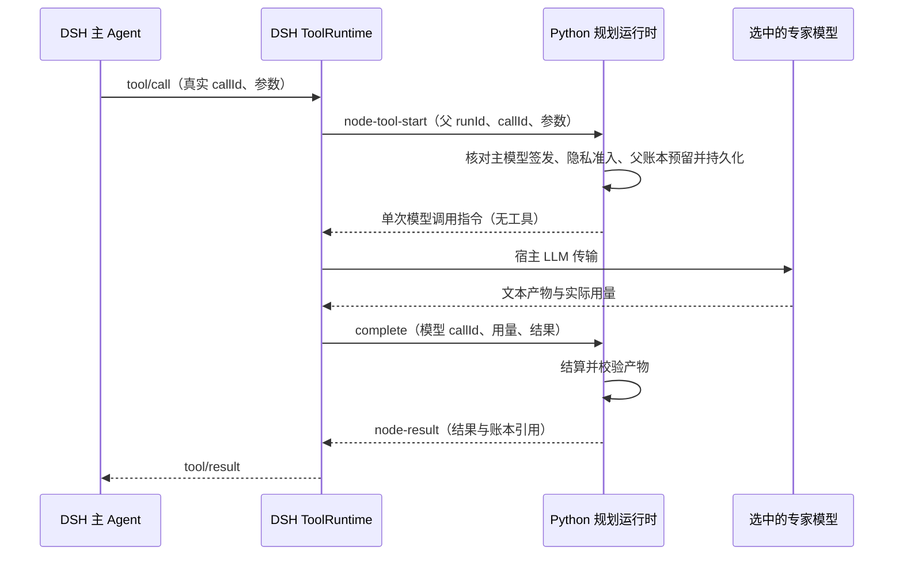

# 专家节点工具实验协议

关联 [Issue #200](https://github.com/AEALab/RefractRouter/issues/200)。
本协议冻结零付费 P0–P1 的接口与验收范围；质量收益尚未验证。

## 定位与术语

当前规划路由沿用宿主原生 Agent 循环，在模型请求之间选择模型，不创建 DAG。
DAG 拆分与组合执行属于独立研究入口。“是否拆分”属于另一项执行方式选择研究。

`node-as-tool` 的含义是：主 Agent 通过真实工具调用委派一次文本分析，结果再返回主循环。
只有主循环共享一段连续历史；专家仍收到单独的输入视图。输入取舍、结果摘要与额外调用
都会产生开销，不能声称只剩一个总上下文窗口，也不能声称消除了交接损失。

第一版通过研究脚本显式安装稳定工具，不接入产品 `apply`、设置页或标准模型 API。
这只是原型入口，不是已安装客户端或任意 Agent 已兼容的证据。
Python 复用 `PlanningRuntime.execute/issue/complete`，拥有 Static／规则 Stage 选模、
隐私准入、预留、结算与证据。TypeScript 负责 DSH 注册、身份、模型传输与工具结果回传。
不复用依赖 `TaskDAG` 的节点执行器，不新建 DAG 或内部宿主工具循环。

## 工具目录

Python `node-tools-catalog` 返回 `owner=python-core`、版本、意图映射、限额及 schema。
稳定工具名为 `refract_expert`，按 `analyze`、`check`、`synthesize` 三种用户意图分组。
工具参数为 `intent/task/context`，禁止额外字段；只接收非空文本。
专家仅收到显式传递的任务和材料，不隐式复制整段主会话，也不携带参考答案。

显式 `nodeTools.enabled=true` 必须在父任务开始前冻结；默认省略即关闭。
只支持有限调用数和期限的主任务 Static 与规则 Stage，暂不接受子 run、其他策略或混合 Judge。
默认最多 3 次专家调用、40 个合并工具定义、12000 个任务及材料字符、1024 个专家输出 token。
冻结项可缩小；工具定义最多 50 个、专家调用最多 16 次、输出最多 8192 token。
文章中的 30–50 是经验提示，本实验选择 40 作为工程限制，不把它当作已证明的退化阈值。
工具名冲突、定义被替换、总数超限或缺少宿主注册时在派发前拒绝。

## 调用与回执

只有父任务已接受并向宿主放行的主模型直接函数工具调用可以执行。
首版不支持 `run_code`／PTC 包装后的间接工具调用；当前夹具使用直接工具模式。
调用 ID 与参数必须匹配；重复、伪造及并行请求不重新派发。节点调用同步串行，
计入同一个父 run 的 `PlanningBudget`，包括总模型调用数、生产费用及参考成本。
不通过 `begin(child=true)` 创建独立预算，因此本原型不依赖通用子 Agent 共享预算。
现有任意子 Agent 的生命周期与共享预算仍未实现。

专家无宿主工具权限，不能再委派。主模型和专家共用既有选模状态与 Stage 证据消费机制，
专家的模型请求也计入运行时步骤序列。当前不新增节点专用策略，不宣称已验证其效果。

专家输出 JSON：`artifact` 正文、`quotes` 逐字引文列表、`limitations` 证据限制列表。
引文必须是实际传入 `context` 的子串；这只检查逐字对应，不证明语义正确或事实完整。
非正常结束、工具调用、结构错误和伪造引文均在实际费用结算后停止，不自动重试。
返回主 Agent 的工具结果包含上述产物、真实模型、用量、计费单位、费用和 evidenceId。

本地受限证据保存完整实际请求和结果；历史 UI 查询移除原始模型请求与回复。
为了让主 Agent 使用产物，工具结果正文会进入其会话；不能承诺专家结果只以哈希出现。
公开报告只采用合成夹具；真实材料须遵循既有数据域约束。

## 停止与取消

专家实际输入在派发前经同一隐私准入，不借用主模型输入的分级结果。
找不到准入模型或额度不足时记录拒因，不派发、不给其他数据域放行。
父任务取消联动在途模型信号；已派发但未确认用量保留预留，停止父任务。
迟到的有效回执只能补结算，不能交付结果或再签发调用；重复回执不得重复记账。
离线验收强制禁网，模拟 provider 的重试为零；未来付费 profile 必须另行核对实际 provider 的零重试配置。失败、取消、用量未知、拒绝和成功都保留工具 ID 与模型调用 ID 关联。

## 零付费验收

- Python 行为测试验证目录、父账本上限、Stage 复用、隐私、重复、取消、未知用量与输出校验。
- TypeScript 严格检查与契约测试验证注册、注销、身份传递和默认关闭。
- 已安装 DSH 的真实 `LlmRuntime + Session + ToolRuntime` 使用离线模型夹具，
  分别以 Static 和 Stage 完成至少 3 次专家调用、真实 call/result 配对及父账本结算。
- Node 和 Python 模型进程阻断网络；保留会话事件、原始账本与验收 JSON。
- 此验收只证明对应集成路径可执行，不证明质量、成本或时延收益，不替代付费 P2。

关闭实验：不调用 `registerExperimentalNodeTools`，不在 `begin` 传 `nodeTools`。
默认产品入口无需修改配置；研究脚本完成后注销工具、结束工作进程。
