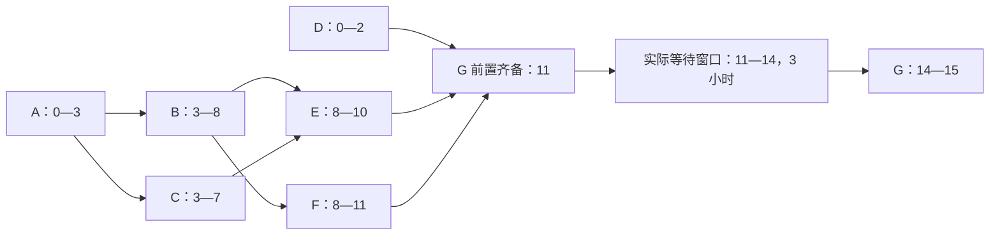

# 正文回读与字段检查的区别

本记录是助手对已完成基线正文的一次回读，不是独立人工双审。
它不改变冻结主判据、提示选择或执行参数，也不宣布整个样本语义通过。

## 发布窗口等待的表达歧义

样本：`prompt-audit-release-dependencies-one-shot-explicit-verification-r1`。
该样本的结构字段和引用检查全部通过。正文正确给出了技术完工 12、窗口完工 15，
但随后写到“12 到 14 是窗口等待”。这句话没有清楚说明实际排程中的完整等待区间。

根据公开材料，D、E、F 分别于 2、10、11 完成，所以 G 的前置工作在 11 全部齐备。
忽略窗口时，G 为 11—12；要求 G 完整位于 [14,16] 时，最早为 14—15。
因此实际执行中 G 等待发布窗口的完整区间是 **11—14，共 3 小时**；
最终完工也从 12 推迟到 15，推迟 3 小时。“12—14”是其中一部分，
不能用它代替完整等待区间或据此得出只等待 2 小时。
这项观察记为需要澄清的正文表达，不能擅自把原冻结评分由 pass 改成 fail。

这是公开材料的核对示意，不是模型实际生成的研究 DAG。
两槽可行排程为：槽一 A 0—3、B 3—8、E 8—10、G 14—15；
槽二 D 0—2、C 3—7、F 8—11。技术路径 A—B—F—G 长度 12，
对应的可行排程达到该下界；加入窗口后不早于 14+1=15，可行排程同样达到下界。

## 流水任务正文的已核对要点

第一轮两种提示的正文均说明：

- `event_id` 为全局身份，首次保留完整载荷，重复与冲突分别处理。
- pending 和被拒退款仍占用首次身份；pending 不计现金。
- `r4` 第二次出现是冲突，不再重复计入被拒退款。
- 退款先检查本订单余额，不能跨订单垫付；最终余额与净额均为 180。
- 修正代码和测试只作建议，没有声称已经执行。

这些是对具体正文与公开材料的回读，不证明建议代码已经运行或对未知事件序列正确。
两种提示仍各有 `wrong_key:sources` 的字段引用不足；该冻结检查结果原样保留。

## 对本次比较的影响

最终结果需要并列说明字段值、引用完整性、正文表达、总费用与耗时。
字段通过不能自动推出整体质量通过；字段因引用不足而失败，也不能自动解释成数值算错。
本记录仅帮助解释结果，不用于重新调优当前三路线实验。
