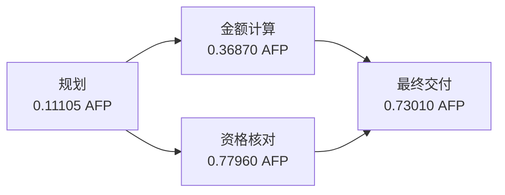

# 首个同采样 DAG 的原始回执核对

这是运行中的只读阶段快照：18 个基线开发、8 个接续 Native 比较及 1 个新 DAG，
共 27 个已收录样本。整批仍在继续；这不是完整三路线结论。

首个新 DAG 为采购第 1 轮，3 个业务节点、另计 1 次规划请求，实际峰值并发为 2。
4 次原始 HTTP 请求均显式 `temperature=0`、`max_output_tokens=384000`，
提供方实际版本均为 `deepseek-v4-flash-ga-260731`，与已接续 Native 的实际版本一致。
请求和回执通过逐调用关联 ID 绑定，审计重新计算用量与 AFP，没有差额或关联错误。

| 调用 | 总输出 token | AFP |
|---|---:|---:|
| 规划 | 684 | 0.111050 |
| 金额计算 | 6074 | 0.368700 |
| 资格核对 | 14294 | 0.779600 |
| 最终交付 | 11685 | 0.730100 |
| 合计 | 32737 | 1.989450 |

任务耗时 452.618 秒，包含规划与节点执行。最终 JSON 可解析，全部关键字段值正确，
但 8 个字段的冻结来源覆盖未达，主判据仍为 fail；不能把它写成 8 个数值错误。
例如 `cost_a` 只列 s2，冻结规则还要求数量来源 s1；`confirmed_eligible` 只列 s1、s5，
冻结规则还要求其余候选的来源。完整集合规则保持原样，不根据这次结果调整。



快照累计已收录真实调用 58 次，费用与历史预留 34.977350 AFP。
后续在途调用由个案账本另行保护，不能将本快照当成平台的实时剩余额度。
AFP 是按冻结费率核算的套餐用量，供应商账单未独立核对。

后续即使继续追加主摘要，也可用这里的快照重放只读审计，不增加模型请求：

```bash
uv run python experiments/audit_node_tool_pilot.py \
  --result-dir reports/node-tool-pilot-20261029-live-04 \
  --summary-snapshot reports/node-tool-pilot-20261029-audit-08/summary.snapshot.json \
  --output-dir reports/新的只读复核目录
```

完整逐调用回执、原始证据哈希与原评分见 `audit.json`；主样本继续按新协议采集，
旧未显式温度的 DAG 仍只保留为诊断并计入累计费用。
