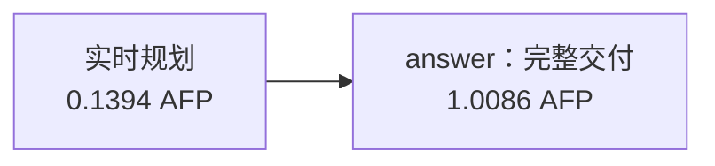

# 规划路径未拆分的真实案例

发布排程第 1 轮按同采样协议完成：规划器选择 1 个业务节点 `answer`，
理由为“单一强耦合排程计算，无独立分支，合并校验与交付”。这是模型本次的规划判断，
不等于已经证明单节点最优。研究允许规划器生成 1—4 节点，不为展示拆分而强制多节点。

业务图节点数是 1，实际 API 调用数是 2。规划成本和等待均计入总量：
1.148000 AFP，364.733 秒；本次没有工作节点并行，也没有专家调用。
两次实际请求均为 `temperature=0`、输出容量 384000，原始响应版本与 Native 一致。
核对回执、关联 ID 和费用的错误数为 0。

## 同任务同轮次的阶段对照

| 路线 | API 调用 | JSON 合同 | 关键字段值 | 来源覆盖 | AFP | 秒数 |
|---|---:|---|---|---|---:|---:|
| 一次性回答 | 1 | 通过 | 正确 | 未达 | 1.259800 | 411.710 |
| 按需专家 | 3 | 未通过 | 未评* | 未评* | 1.085800 | 218.652 |
| 规划路径：未拆分 | 2 | 通过 | 正确 | 未达 | 1.148000 | 364.733 |

`*` 按需专家原始 JSON 含未转义换行，冻结主判据保持 fail；
只读副本的诊断不能使原交付改记为通过，详见 `../node-tool-pilot-20261029-json-contract-case/`。
一次性回答和规划路径均缺少 `technical_finish`、`critical_path` 规定的 s2 引用，
不能把来源覆盖不足解释成技术完成时间或关键路径算错。

规划路径这次未拆分，所以其费用或时间差不能称为多节点拆分收益。
对照也包含提示、上下文及采集时序差异，且只有一个任务的一次结果。
不能用这一例判定某路线总体优越；主比较仍须完成全部 27 个样本。

## 稳定证据

`summary.snapshot.json` 记录 28 个已收录样本；`audit.json` 保存逐调用原始回执哈希及重算费用。
快照累计 60 次请求、36.125350 AFP，含历史预留。整批仍在运行，在途调用另由核心账本保护。
AFP 是冻结费率核算的套餐用量，非独立确认的供应商账单。
可以参照前一份审计的 `--summary-snapshot` 命令，只读重放这里的快照。
