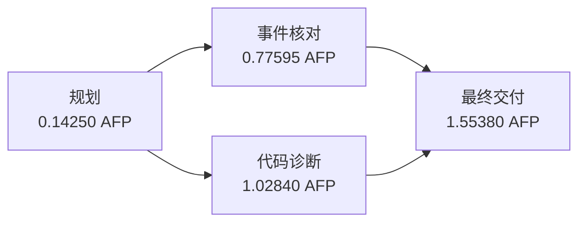

# 同采样第一轮三任务比较

三条路线第一轮各完成 3 个任务，共 9 个比较样本。全部实际请求显式 `temperature=0`，
输出容量 384000，原始回执报告模型版本均为 `deepseek-v4-flash-ga-260731`。
本页使用修订后的 DAG，不导入旧未显式温度的 DAG 结果。
Native 为参数一致的原样接续；采集时间不再保持原先全体交错，不能解释为单因素因果实验。

完整研究为三个任务各重复三轮、三条路线，共 27 个比较样本；
本页只是第一轮，三个任务不能写成九个独立任务，也不据此宣布总体优越。

## 结果分解

| 路线 | 执行返回 | JSON 可解析 | 字段值全部正确 | 冻结主判据通过 | AFP 合计 | 任务秒数中位数 | API 调用 |
|---|---:|---:|---:|---:|---:|---:|---:|
| 一次性回答 | 3/3 | 3/3 | 3/3 | 1/3 | 2.869350 | 290.917 | 3 |
| 按需专家 | 3/3 | 2/3 | 2/3* | 1/3 | 4.130800 | 218.652 | 9 |
| DAG 规划路径 | 3/3 | 3/3 | 3/3 | 0/3 | 6.638100 | 452.618 | 10 |

`*` 发布按需专家的原交付有 JSON 编码错误，原合同下字段未评，不能将空检查列表当作正确。
已有只读副本诊断不改变原评分。其余 8 个可解析交付的关键字段值均正确。
除格式失败外，未通过主判据的原因均为冻结来源覆盖不足，不是数值错误。

| 任务 | 路线 | JSON | 字段值 | 来源覆盖 | AFP | 秒数 |
|---|---|---|---|---|---:|---:|
| 采购 | 一次性回答 | 通过 | 正确 | 未达 | 0.976950 | 290.917 |
| 采购 | 按需专家 | 通过 | 正确 | 通过 | 1.234700 | 215.325 |
| 采购 | DAG | 通过 | 正确 | 未达 | 1.989450 | 452.618 |
| 发布 | 一次性回答 | 通过 | 正确 | 未达 | 1.259800 | 411.710 |
| 发布 | 按需专家 | 未通过 | 未评 | 未评 | 1.085800 | 218.652 |
| 发布 | 规划路径未拆分 | 通过 | 正确 | 未达 | 1.148000 | 364.733 |
| 流水 | 一次性回答 | 通过 | 正确 | 通过 | 0.632600 | 164.331 |
| 流水 | 按需专家 | 通过 | 正确 | 未达 | 1.810300 | 376.855 |
| 流水 | DAG | 通过 | 正确 | 未达 | 3.500650 | 812.347 |

本轮按需专家总费用介于一次性回答与规划路径之间；中位耗时较低，但其中包含格式失败样本，
不能把它写成“满足同等质量条件后更快”。一次性回答和专家的主判据计数相同也不代表质量等价。
关键字段的数值表现接近上限，本轮没有观察到专家相对基线修复一个最终数值错误。

## 机制实际覆盖

按需专家三个样本各调用一次 `check`，每例共两个主模型请求加一个专家请求。
专家可以产生错误：采购第 1 轮中间产物的 A 乘法错误没有进入最终答案。
发布和流水在委派前已给正确数值草案，所以发生工具调用不能直接当作错误修复证据。
详见 `../node-tool-pilot-20261029-sampling-amendment/native-body-readback.md`。

规划器的业务图节点数分别为 3、1、3；API 调用数分别为 4、2、4，均含一次规划。
采购与流水实际峰值并发为 2；发布选择单节点交付，不能算作多节点拆分的收益。
流水实际轨迹如下，总耗时包含规划、并行工作及最终交付：

流水两个工作节点合计输出 33475 token，最终交付另输出 26593，规划输出 1313；
总计 61381，包含思考，计费时没有再次叠加思考细项。
最终关键值正确，`wrong_key` 未列出规则要求的 s1 来源，主判据为 fail。
正文还讨论了另一种冲突回滚口径；这类自由正文解释仍须语义审查，字段正确不等于整体语义通过。

## 费用与稳定证据

本快照共收录 29 个样本：18 个基线开发、第一轮 9 个比较及采购第二轮的两个接续 Native。
跨批累计请求 64 次、39.626000 AFP；当前在途调用由核心个案账本另行保护。

| 费用归属 | AFP |
|---|---:|
| 18 个基线提示开发样本 | 12.531450 |
| 第一轮 9 个比较样本 | 13.638250 |
| 采购第二轮两个接续 Native | 2.300550 |
| 旧未显式温度 DAG，仅诊断 | 10.525750 |
| 原始失败调用未知用量预留 | 0.630000 |
| 累计 | 39.626000 |

旧失败和诊断费用继续占原先批准的 286 AFP、135 请求累计额度，没有按目录重置。
本快照尚余 16 个计划个案，按冻结的各例最多调用数合计 70 次，当前授权剩余 71 次；
已完成个案实际调用低于上界，因此余下调用次数可完整纳入原授权。费用仍逐调用按完整容量预留，
不能把这一次数核对解读成无限费用授权。
AFP 是冻结费率核算的套餐用量，不是独立确认的供应商账单。

`audit.json` 逐调用核对原始回执、请求参数、费用及来源绑定，错误数为 0；
`summary.snapshot.json` 是稳定的阶段快照，`first-repeat.csv` 可直接检查表格数据，
`first-repeat-bindings.json` 绑定快照和实际模型身份。审计通过只说明证据与费用一致。

可以参照前述审计的 `--summary-snapshot` 命令只读重放本目录快照。
完整研究继续执行第二、三轮；最终报告还须包含预先冻结的五组全新采集配对补充分析。
当前收益判定保持 `Insufficient-evidence`。
