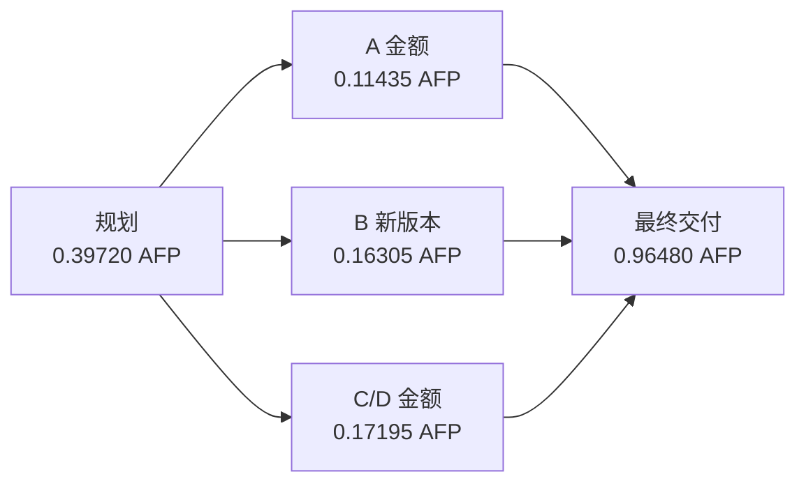

# 采购第二轮与重复表现

采购第二轮三路线已齐，均为同一 Flash 实际版本和显式零温度。
本轮新增 DAG 实际规划 4 个业务节点，另计一次规划，共 5 次 API 调用；
三个计算节点由两槽调度，实际峰值并发为 2。

规划、工作和最终交付合计 1.811350 AFP，451.317 秒；输出容量均为 384000，
没有隐藏的小输出上限。JSON 可解析、关键字段值正确，只有 `confirmed_eligible` 的
冻结来源覆盖未达。原始回执、请求参数和费用审计错误数为 0。

## 两轮并列观察

| 轮次 | 路线 | 关键字段值 | 来源覆盖 | AFP | 秒数 |
|---|---|---|---|---:|---:|
| 1 | 一次性回答 | 正确 | 未达 | 0.976950 | 290.917 |
| 1 | 按需专家 | 正确 | 通过 | 1.234700 | 215.325 |
| 1 | DAG | 正确 | 未达 | 1.989450 | 452.618 |
| 2 | 一次性回答 | 正确 | 通过 | 0.669550 | 204.580 |
| 2 | 按需专家 | 正确 | 未达 | 1.631000 | 359.026 |
| 2 | DAG | 正确 | 未达 | 1.811350 | 451.317 |

采购第一轮的按需专家引用覆盖通过，第二轮却未重复：一次性回答通过，
按需专家缺 `b_confirmed_eligible` 要求的 s1。不能仅保留有利于专家的第一轮。
这些差异属于冻结引用口径，不能写成金额或资格条件算错；同一任务的重复也不是独立新任务。
本观察不改变评分、提示或后续执行，第三轮仍按原计划采集。

## 剩余样本与证据

本快照累计完成 12/27 个比较，连同基线开发共 30 个样本。
累计 69 次真实请求、41.437350 AFP，包含旧诊断和原始失败预留；
在途请求另由当前个案账本保护，AFP 仍为按冻结费率计算的套餐用量。

剩余正好是预先冻结的五组全新采集配对：发布和流水第 2 轮，全部三个任务第 3 轮。
这些组的三条路线都在修订后采集，用于补充观察接续样本的时序影响，
分组在新预检时已冻结，不按胜负筛选。主分析仍保留完整 9 组。

原始回执与逐调用绑定见 `audit.json`，稳定样本见 `summary.snapshot.json`。
批次继续，完整结论仍须等全部三轮完成。
