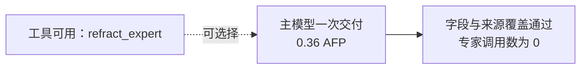

# 工具可用但没有调用专家的样本

发布第 2 轮的 `node-as-tool` 路线已完成：一次主请求，0 次专家，
1,371 输入 token、5,829 总输出 token，0.360000 AFP，86.630 秒。
最终 JSON、关键字段值及冻结来源覆盖均通过。自由正文的独立语义审查仍未完成。

原始请求的 `tools` 包含 `refract_expert`，父账本的专家配置为启用，
`nodeTools.invocations` 是空列表；账本仅有一次 `execute` 调用。
因此这是模型在工具实际可用时直接交付，并非工具未注册或被宿主隐藏。
实际模型仍为 Flash，`temperature=0`，输出容量 384000。

本样本仍保留在工具可用路线的完整比较中，不能因为未调用专家而筛除。
但也不能把这一例通过或低费用归因于专家协助，因为实际没有专家调用。
路线表现与机制触发要分开汇总；工具说明还改变主提示，不能将路线差异解释成单因素因果证明。

同组 DAG 也已完成：3 个业务节点加一次规划，1.874500 AFP，528.904 秒，
JSON 可解析、关键字段值正确，`technical_finish` 的冻结来源覆盖未达。
本快照中一次性回答尚在执行，不能将两个已完成样本冒充完整配对。

`audit.json` 和 `summary.snapshot.json` 稳定收录 32 个样本，其中 14 个为比较样本。
原始回执、参数、关联和费用核对错误数为 0；累计 74 次请求、43.671850 AFP，
含旧诊断及原始失败预留。在途调用另由核心账本保护，供应商账单未独立确认。
完整研究继续，主分析和预先冻结的全新采集配对都保留这一未触发专家的样本。
