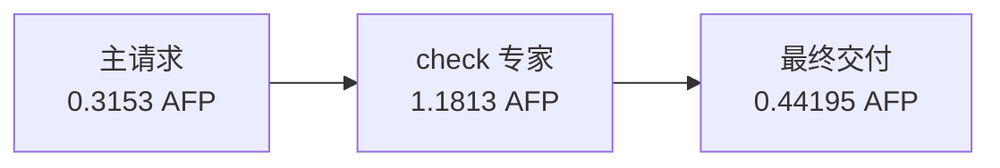

# 误拒收修订后的完整重采

流水第 2 轮按需专家已重新完成，原始失败仍在 `live-04` 保存，未追改分数或清除费用。
新样本 3 次 API 请求，包含一次 `check` 专家，最终 JSON 可解析、关键字段值正确，
`wrong_key` 未列出冻结规则要求的 s1 来源，主判据仍为 fail。

| 调用 | 输入 token | 总输出 token | AFP |
|---|---:|---:|---:|
| 主模型提出复核 | 1522 | 4784 | 0.315300 |
| 专家复核 | 783 | 22843 | 1.181300 |
| 主模型最终交付 | 7468 | 1371 | 0.441950 |
| 合计 | 9773 | 28998 | 1.938550 |

任务耗时 423.862 秒。专家 22843 输出 token 包含思考，正常返回且完整结算，
三个请求的实际输出容量均为 384000。
本次 4 条引文均逐字位于 `context`，来源位置写入了 `quoteSources`。
因此本例证明新版本完成了一次完整交互，但没有在真实新请求中触发 task 专属引文分支。
该分支由原错误产物的只读回放及核心回归测试验证，不能把重采完成解释成单因素因果证据。

## 原失败并列保留

原尝试 2 次请求、1.357800 AFP，因 context-only 字段边界拒收而没有最终交付；
被拒的两条引文都逐字位于 `task`。原停止前核心耗时 385.107 秒，外层耗时 385.734 秒。
原样本仍为 `failed / not-evaluated`。原停止耗时不能当成任务完成时长，与新尝试直接比较快慢。
这一个任务—轮次的两次研究尝试合计 3.296350 AFP，全部占用原授权，
主比较使用修订后的完整重采，旧尝试作为诊断与敏感性记录另列。

本快照共 38 个主样本，其中 20/27 个比较；累计 91 次请求、53.670250 AFP，
包含全部历史诊断和未知预留。新批次接续了 37 个兼容样本，原模型提示、任务及最终评分不变。
原始回执、工具可用性、采样、容量和费用核对错误数为 0；
AFP 仍为按冻结费率计算的套餐用量，供应商账单未独立确认。

后续第三轮继续执行。完整最终结论仍须等全部 27 个比较完成。
