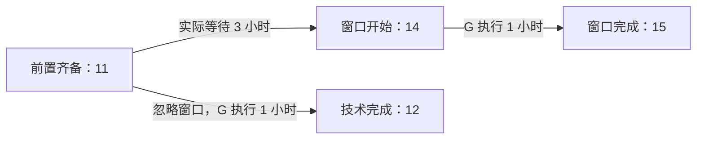

# 正文字段之外的回读发现

本记录是助手事后回读，不是独立真人语义双审，不修改冻结评分，也不追加模型调用。
已回读全部 26 个严格可解析交付的关键计算、约束及字段—正文一致性；
另一个原始 JSON 合同失败样本单列，未把宽容解码当作原合同通过。
逐条来源和输出哈希见 `review.json`。

## 字段正确，正文等待口径仍有问题

发布第 3 轮按需专家的字段正确给出：前置齐备 11、技术完成 12、窗口完成 15。
但正文写“12–14 小时为等待窗口产生的空闲”，并称“窗口等待（2 小时）”。
实际窗口化排程在 11 已完成前置，G 必须到 14 才开始，因此实际等待是 3 小时，
不是从假想的无窗口 G 完成时刻 12 再算两小时。正文混用了两个排程，漏掉了 11–12。

提供方原始 SSE 中的最终文本与宿主交付逐字一致，问题不是宿主改写造成。
原始冻结主判据仍是来源覆盖未达；这里另记正文时序说明的问题，不追改字段分数。

交给专家的任务、上下文及专家产物没有最终这段“两小时等待”描述。
专家确认了 11、12、15 等计算，主模型之后生成了整份交付。
这一轨迹说明“专家核对过草案数值”不等于“最终正文已被完整审查”，
不能把接口成功或结构化字段正确当成整份答案质量已认证。

## 范围

采购已按三路线三轮回读金额、税、折扣、版本、日期和资格筛选；
发布已回读两槽可行排程、关键路径、窗口和批准；
流水已回读前两轮的顺序去重、载荷冲突、退款余额、pending 与错误字段。
这不代表所有措辞、所有替代解释或整体语义已通过独立评审。
引用覆盖、JSON 合同、正文问题与资源用量在最终报告中分别呈现。
