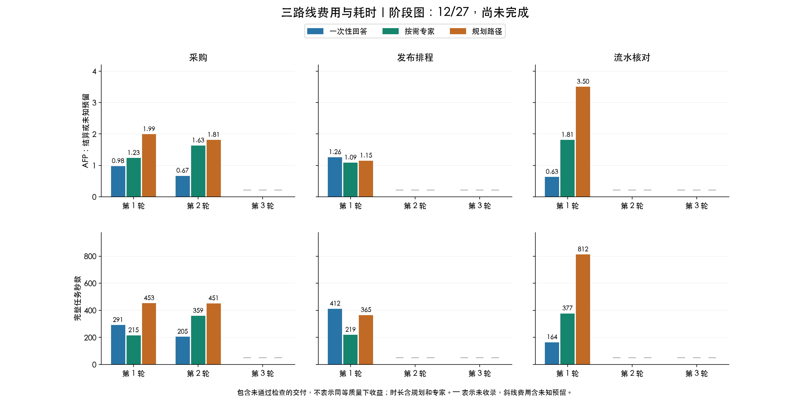
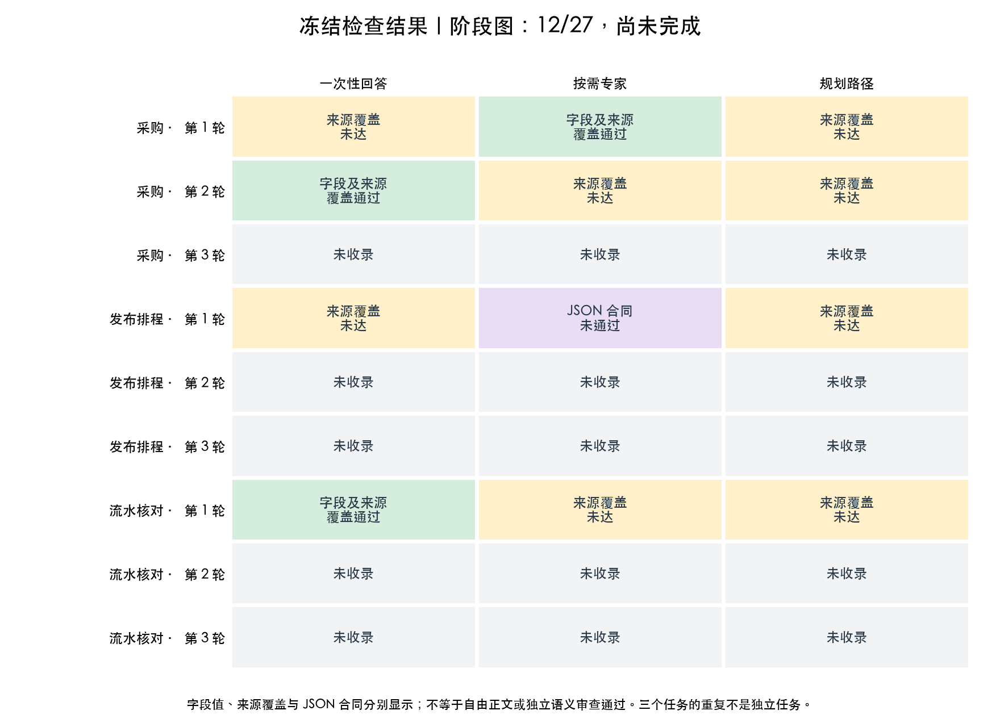

# 三路线阶段图与生成验收

本页只呈现审计第 11 份快照中的 **12/27** 个比较样本，另 15 个未收录。
它不是完整三轮结论，也不是实时进度页面。



柱高仅使用原样记录的费用和耗时，不给缺失数据补零；未通过检查的交付也保留费用与耗时。
这些柱子不表示“同等质量下更省或更快”。规划和专家费用、等待均包含于各自个案，
单独的基线提示开发、历史诊断及原始失败预留在累计账本另列，不混入比较样本的柱高。
AFP 是按冻结费率计算的套餐用量，非人民币实付或独立确认的供应商账单。



绿色只表示字段值和冻结来源覆盖均通过；黄色为来源覆盖未达；紫色为原 JSON 合同失败。
灰色为尚未收录，不是模型失败。整体语义质量仍须另行审查；三个任务的重复不是独立任务样本。
规划路径的实际节点数可能为一，不能把每根规划路径柱子都称为多节点拆分。

## 生成与核对

图表由独立分析脚本生成，不修改主研究实现、模型依赖、原评分或预算。
`summary.snapshot.json` 是输入副本，`plot-metadata.json` 绑定摘要哈希、Matplotlib 版本、
原始数据最大值及实际坐标轴上界，`plotted-data.csv` 列出全部 27 个计划位置。
缺失位置的指标为空，不是 0。PNG 和 SVG 均保留，可逐项与原账本核对。

目视验收发现过初稿共享坐标轴截掉最高柱的问题，当前版本已经修复并检查：
3.500650 AFP 和 812.347 秒的最高柱及标注均完整可见；所有子图的上界也进入元数据。
中文文字、图例、缺失标记及检查分类已目视核对。

复现此阶段图，需要 Matplotlib 和支持中文的字体：

```bash
uv run --no-project --with matplotlib python experiments/plot_node_tool_pilot.py \
  --result-dir reports/node-tool-pilot-20261029-live-04 \
  --summary-snapshot reports/node-tool-pilot-20261029-audit-11/summary.snapshot.json \
  --output-dir reports/新的阶段图目录 --allow-partial
```

其他字体位置可通过 `--font` 指定。生成完整结果图时去掉 `--allow-partial`；
默认要求 45 个样本、27 个比较及 18 个配对全部齐全，不能把阶段图标成完整研究。
图表显示的字段、格式、缺失、身份去重和完整性规则另有 3 项无网络测试。
