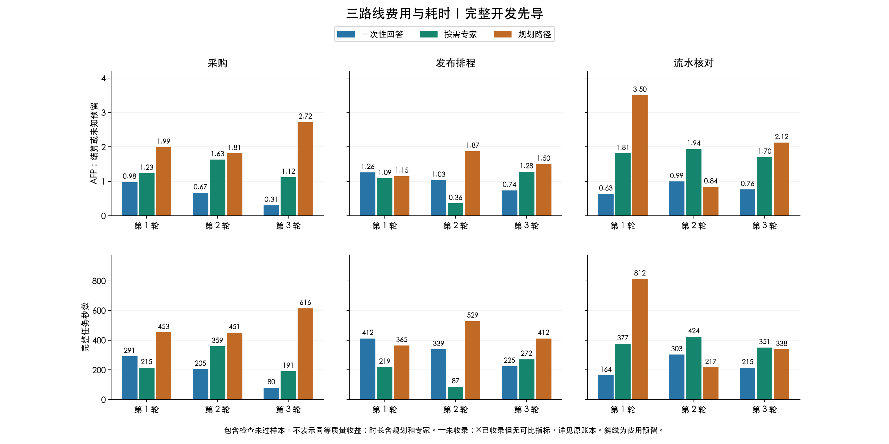
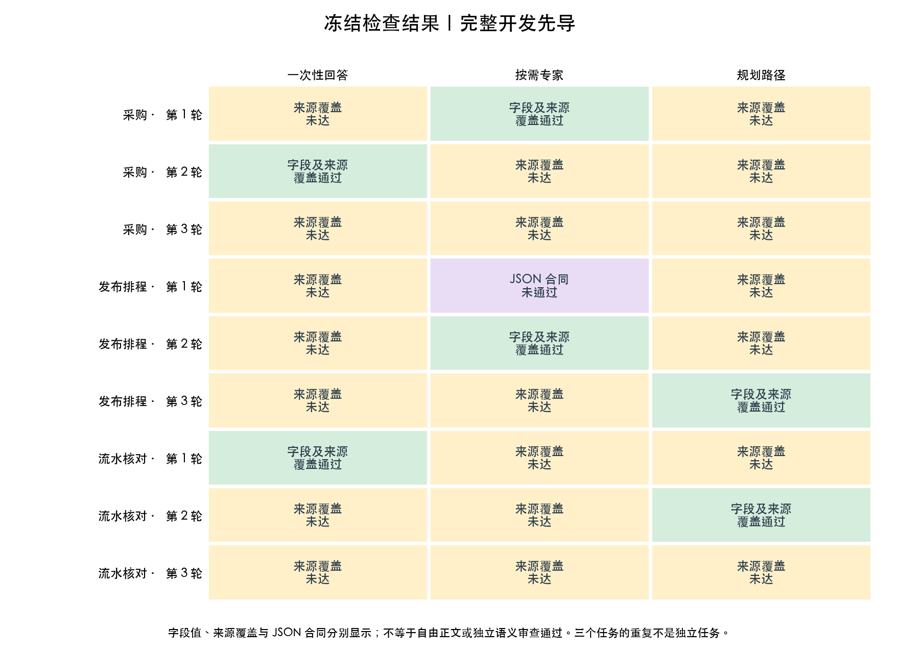

# 按需专家相对一次性回答与 DAG：当日先导结果

本批没有证明按需专家稳定优于一次性回答。三个构造任务中，一次性回答已把关键字段全部算对；
按需专家没有增加可观察的数值改进，费用更高，执行返回耗时中位数也更长。
相对实时规划 DAG，按需专家的资源开销较低，但整体质量尚未获等价认证，不能宣布净收益或正式 Pareto 优势。

据此建议继续保留显式研究入口，优先校准语义验收与任务难度；
本批证据不足以支持开发跨自动／规划模式的通用“是否拆分”选择器。
先导采集和核对已完成，收益判定保持 **`Insufficient-evidence`**。

## 范围与完整性

3 个合成开发任务：采购约束与报价版本、两槽发布排程、事件流水与去重代码诊断。
每题每路线 3 次，共 27 个比较；此前 2 个 one-shot 提示各做 9 次开发，共 18 个基线样本。
总计 45 个主样本、18 个相对 one-shot 的配对，无缺失配对。
重复不是独立新任务，材料没有作为未见留出集。

模型固定 `deepseek-v4-flash`，主分析 85 次请求的原始回执均报告
`deepseek-v4-flash-ga-260731`。全部实际请求显式 `temperature=0`，输出容量 384000，
思考和 top_p 沿用提供方默认；比较阶段执行不设置人为短超时，HTTP 重试和模型回退均为零。
18 个基线中有 3 个接续自早期十分钟时限版本，均已在时限内正常完成，原设置与证据保留；
不宣称所有历史版本的时间配置完全相同。
基线只在预先冻结的两个提示中按规则选择 `explicit-verification`，不使用比较结果调参；
这种有界开发不能称为全局最佳提示。

三路线使用相同公共任务材料与最终交付合同；私有参考不进入模型请求。
工具说明、职责提示、上下文投影、调度及流式／非流式适配仍有差别，比较的是当前完整实现。
结果不识别纯粹的专家调用、交接损失或拆分的单因素因果效应。

## 完整结果

| 路线 | JSON 可解析/9 | 字段值正确/可解析 | 冻结字段及来源覆盖通过/9 | 模型请求 | AFP 合计 | 返回耗时中位数，秒 |
|---|---:|---:|---:|---:|---:|---:|
| 一次性回答 | 9/9 | 9/9 | 2/9 | 9 | 7.373500 | 225.031 |
| 按需专家 | 8/9 | 8/8 | 2/9 | 25 | 12.157700 | 271.628 |
| 实时规划 DAG | 9/9 | 9/9 | 2/9 | 33 | 17.502100 | 451.317 |

三个路线均返回了 9 份文本，其中专家路线有一份不符合原 JSON 合同，字段未评，不能当作算对或零错误。
26 个严格可解析交付的关键字段值全部正确；来源覆盖未达与数值错误分别解释。
耗时包括规划、专家及模型调用，主表也包含格式失败的返回；它不是可接受质量下的交付时长。

本批按需专家比 one-shot 总费用高 **64.9%**，返回耗时中位数长 **20.7%**；
比实时 DAG 总费用低 **30.5%**，中位数短 **39.8%**。这些是本批观测值，不能推广为架构固有规律。
Node 路线相对 one-shot 只有 2/9 例费用更低、3/9 例返回更快。
两例低费用中，一例 JSON 失败，另一例实际没有调用专家。
事后查看真正调用专家且可解析的 7 例，其费用都高于匹配的 one-shot；
这是机制诊断，主分析仍保留全部 9 例，没有按是否调用或胜负筛选。





各路线相对 one-shot 的冻结判据翻转均为：2 次 fail→pass、2 次 pass→fail、5 次 fail→fail，
没有稳定通过配对。相同通过数不代表质量等价，失败性质与出现的任务也不同。

### 为什么来源覆盖分数不能当作整体质量

冻结参考对发布的 `technical_finish`、`critical_path` 强制同时列 s1、s2，
而有效清单 s1 已含完整时长与依赖，s2 是旧版本替代说明。
采购的合格集合还要求列出被淘汰候选的材料。
模型可能计算正确却少列规定来源；这说明未达既定覆盖口径，不能直接说算错或没有逻辑支持。
该覆盖口径未获独立语义校准，原规则和原分数仍保持不变。

## 实际机制与总费用

专家工具在 8/9 个样本触发，共 8 次，全部选择 `check`；本批没有验证 `analyze/synthesize` 的实际收益。
这些专家仍是同一 Flash 的职责提示，不是不同训练或已经认证的专业模型。
一次工具可用但未触发的样本按原计划留在总体比较中。

DAG 实际执行节点数为 1—4：7/9 例多节点，5/9 例实际并行。
发布第 1 轮和流水第 2 轮选择单节点，规划仍另计一次请求。
这些是模型求解工作流节点，区别于题目中发布 A—G 的业务依赖图；模型没有真实执行采购、发布或退款。

| 路线 | 累计输入 token | 总输出 token | 其中思考 token | 实际请求 |
|---|---:|---:|---:|---:|
| one-shot | 9459 | 138011 | 129119 | 9 |
| 按需专家 | 79458 | 163696 | 140951 | 25 |
| DAG | 59051 | 290991 | 268044 | 33 |

思考细项来自提供方原始回执，已经计入总输出，不能再次叠加费用。
主样本全部 85 次原始回执均提供缓存细项，报告的 cached_tokens 都为 0；
不把宿主丢失的思考细项零计数理解为模型没有思考。
按冻结费率输入、输出和缓存输入均为 0.05 AFP/千 token，不假定折扣。

按需专家费用由主模型 17 次请求 **6.644900 AFP** 与专家 8 次 **5.512800 AFP** 组成。
DAG 由规划 **1.560250 AFP**、工作节点 **7.964700 AFP**、最终交付 **7.977150 AFP** 组成。
主对话保持历史，不表示只发一次请求或重复输入不计费；专家有自己的输入，
主模型后续还会收到历史与工具产物。本批必须看整条调用链，不能只报某个专家请求的价格。

## 可以直接回放的案例

- **工具可用，实际没有专家。** 发布第 2 轮 1 次主请求、0.360000 AFP、86.630 秒，
  字段和来源覆盖通过。请求确实包含专家工具，但调用列表为空，不能归为专家协助的功劳。
- **专家自己会算错。** 采购第 1 轮专家把 240×58 写成 13940，给 A 总价 16352.2；
  主模型最终给出正确 16329.6。schema 和逐字引文通过没有认证算术；
  最终正确也不能反推内部具体纠错过程。
- **返回成功，JSON 不合格。** 发布第 1 轮按需专家的原始 JSON 有未转义换行。
  原始响应与宿主文本一致，完整容量下正常结束并结算；原分数保留 fail，宽容副本诊断不改分。
- **字段正确，终稿仍可能有错。** 发布第 3 轮专家核对了 11/12/15，
  主模型最终正文却把实际 11–14 的三小时等待写成 12–14 的两小时。
  这段表述没有出现在交给专家的草案或专家产物中，专家确认数值不代表后来终稿已经审查。
  具体原始 SSE 对照见[正文回读](../node-tool-pilot-20261029-body-readback/README.md)。

这些回读是本助手事后诊断，不替代独立真人语义双审，不改变冻结评分。

## 修订、重采与时序边界

工程过程中发现的限制和控制问题均公开保留，没有把原失败改成通过：

1. 初次研究小输出上限造成未完成，并丢失有效用量的归档；保留 1 次请求和 0.630000 AFP 未知预留。
   后续贯通完整容量、缓冲、预留、错误结算及不限时语义。
2. 旧 Python DAG 的 Responses 请求没有显式零温度，与 Native 不同。
   旧 5 个 DAG、19 次请求、10.525750 AFP 仅作诊断；主比较重新取得同采样 DAG。
3. 旧引文规范只接受 context，但父模型把材料放入 task，且提示没有清楚告知局部边界。
   两条实际逐字位于 task 的引文被误拒收，原尝试 2 次请求、1.357800 AFP、没有最终交付。
   新规则逐字段匹配 task/context，不拼接、不认证原始事实；原失败与重采结果并列，费用全部累计。

37 个兼容样本原样接续，包含原主判据失败和 JSON 格式失败。
输入字段修订只改变引文验收和私有审计；成功样本的提示、schema、模型可见结果及请求序列不变。
其他真正模型输出失败也不能选择性重试。
当前模型与参数相同不保证生成逐字相同，重采结果不作为修订带来质量收益的独立因果证明。

| 预先定义的补充组 | 路线 | 字段及来源通过 | AFP | 返回秒数中位数 |
|---|---|---:|---:|---:|
| 原采样修订五组 | one-shot | 0/5 | 3.834600 | 225.031 |
| 原采样修订五组 | 按需专家 | 1/5 | 6.395900 | 271.628 |
| 原采样修订五组 | DAG | 2/5 | 9.052650 | 412.200 |
| 字段修订后全部新采集两组 | one-shot | 0/2 | 1.502500 | 219.967 |
| 字段修订后全部新采集两组 | 按需专家 | 0/2 | 2.979200 | 311.215 |
| 字段修订后全部新采集两组 | DAG | 1/2 | 3.620900 | 375.259 |

五组是发布与流水第 2 轮及三个任务第 3 轮，其中误拒收一例在字段修订后重采；
两组是发布与流水第 3 轮。分组按来源在各自新预检时冻结，不按结果挑选，
不当作独立新任务。接续造成部分采集不再全体交错，版本及时间边界均披露。

## 累计预算和核对

| 项目 | 真实请求 | AFP 核算值或预留 |
|---|---:|---:|
| 27 个主比较样本 | 67 | 37.033300 |
| 18 个基线开发样本 | 18 | 12.531450 |
| 旧不同采样 DAG 诊断 | 19 | 10.525750 |
| 原字段误拒收 | 2 | 1.357800 |
| 原始未知用量预留 | 1 | 0.630000 |
| 累计 | **107** | **62.078300** |
| 人类批准上限 | 135 | 286.000000 |

有用量回执的核算值为 61.448300 AFP，另保留 0.630000 AFP 未知预留。
AFP 是套餐用量，非人民币实付；供应商账单未独立确认。
主样本 85 次原始回执已逐条核对用量、费用、模型、采样、容量、工具可用性及并发关联，错误数为 0。
历史诊断只按已有证据核对，不补造缺失的提供方精确版本或用量。

## 工程交付、复现与后续方向

Python 核心负责选模、共用父账本和专家产物校验；TypeScript 负责 DSH 工具注册与宿主适配。
本批真实验证为固定模型 Static 研究入口，标准模型 API 没有因此进入 DAG 或内部工具循环。
源码与研究宿主路径验证不等于任意 Agent 已兼容或插件默认已产品化。

最终全量回归 **2149 项通过**，严格 TypeScript 检查通过，零调用演练覆盖全部 45 个样本与 18 配对。
最终图表已目视核对中文、图例、全部柱高及缺失标记，PNG 和 SVG 均保留。
研究运行使用冻结源码检查点 `bde2ae442`；后续源码变化后应回到该检查点复现同一协议。

原始结果与机器生成报告：[live-05](../node-tool-pilot-20261029-live-05/README.md)；
最终逐调用审计：[audit-19](../node-tool-pilot-20261029-audit-19/audit.json)；
全部 27 行配对数据：[paired-results.csv](paired-results.csv)；
聚合、原始 token 和回执哈希：[metrics.json](metrics.json)；
输入字段修订：[调查与验收](../node-tool-pilot-20261029-quote-amendment/README.md)。

在仓库根目录可零模型调用复现统计：

```bash
uv run python reports/node-tool-pilot-20261029-final/derive-metrics.py
uv run python experiments/audit_node_tool_pilot.py \
  --result-dir reports/node-tool-pilot-20261029-live-05 --output-dir reports/新的只读审计目录
```

图表复现见[完整图表说明](../node-tool-pilot-20261029-final-figures/README.md)。
下一步应先用更有难度的业务材料、经校准的引用规则和独立语义审查确定质量门槛，
再研究同一交互架构下的模型分配。当前三个任务的数值表现已接近上限，
不能据此认定更复杂任务也不需要专家，更不足以训练通用的自动／规划分流器。
