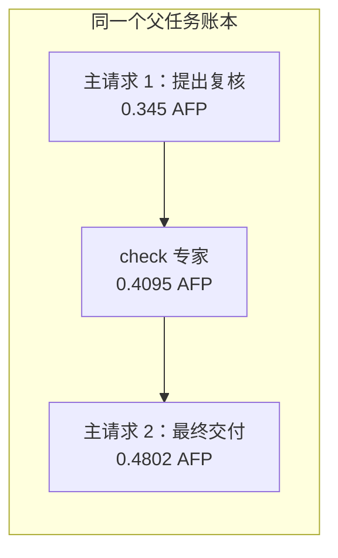

# 首个真实按需专家样本

范围仅为采购任务第一轮的一次性回答与按需专家两个样本；不是全部三路线结论。
两者都完整返回并结算，模型请求均为 DeepSeek V4 Flash，最终交付使用相同冻结提示。

| 路线 | 实际模型请求 | 专家调用 | 字段值及引用检查 | AFP | 任务秒数 |
|---|---:|---:|---|---:|---:|
| 一次性回答 | 1 | 0 | fail | 0.976950 | 290.917 |
| 按需专家 | 3 | 1 | pass | 1.234700 | 215.325 |

本对样本费用增加 0.257750 AFP（26.4%），任务时间减少 75.592 秒（26.0%）。
一次性回答只有 `confirmed_eligible:sources` 未通过，数值和条件字段全对；按需专家补齐了字段引用。
这不是从错误数值翻转为正确数值，也不能由一个样本推断总体收益或质量等价。

## 真实调用与同一账本

下面的三个调用来自同一个 Python planning 记录，没有为专家创建另一个任务或 DAG。

| 调用 | 用途 | 输入 token | 总输出 token | AFP | 状态 |
|---|---|---:|---:|---:|---|
| 主请求：提出复核工具调用 | execute | 1505 | 5395 | 0.345000 | billed |
| check 专家：复核材料 | node-tool | 789 | 7401 | 0.409500 | billed |
| 主请求：最终交付 | execute | 8014 | 1590 | 0.480200 | billed |

专家输出用量为 7401 token，包含思考与正文；已超过被取消的旧 2048 专家额度，仍正常完成。
思考细项应从原始 SSE 核对，宿主计数的零不代表模型没有思考。

## 输入与输出的费用分解

| 路线 | 累计输入 token | 累计总输出 token | 输入 AFP | 输出 AFP |
|---|---:|---:|---:|---:|
| 一次性回答 | 1090 | 18449 | 0.054500 | 0.922450 |
| 按需专家 | 10308 | 14386 | 0.515400 | 0.719300 |

本对样本中，按需专家累计输出更少，但累计输入更多；按冻结费率结算后总费用仍更高。
因此不能只看某个专家请求的价格或只看输出 token。任务耗时是本次观测值，尚不足以隔离服务负载等因素的影响。

## 中间错误没有沿用到最终交付

专家产物写成 `240×58=13,940`，继而给出 A 总价 16352.20。独立复核如下：

`240×58=13920；13920×1.13+600=16329.60`。

主模型最终正文和 `cost_a` 字段均给出正确的 16329.6，没有沿用专家的错值。
专家的 schema 与逐字引文校验都通过了；这类校验没有承诺验证算术。
这里能证明的事实是中间产物含错、最终结果正确，不能仅凭最终值反推内部具体纠错过程。
该案例支持保留主模型复核与中间证据，而不是把专家命名当成准确性认证。

## 复核来源

汇总快照 SHA-256：`207aad35a2b977764b144300bc7ff318e6aa58b3ee64ac30c2b54ae4ae804464`。
核心账本 SHA-256：`749ba52d4563c0c93cbaf27a143ecb2a1baed0749296cab074ec8838f9ade126`。
原始任务目录：`../node-tool-pilot-20261029-live-03/comparison-procurement-versions-node-as-tool-explicit-verification-r1/`。
原始请求、SSE、会话事件与同一父账本均在该目录，专家产物另保存为 `expert-artifact.json`。
逐调用重算费用见 `../node-tool-pilot-20261029-audit-03/audit.json`，没有增加模型请求或改变冻结评分。
