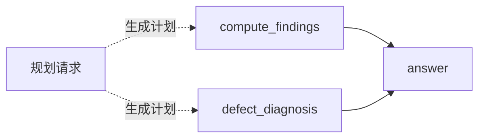

# 第一轮三任务比较

> **后续采样核对修订：** 本页保留阶段原始数值。Native 请求显式 `temperature=0`，
> 旧 DAG 的 Responses 请求未显式携带温度；因此本页涉及 DAG 的比较仅供诊断，
> 不能归因于执行路线。后续同采样主比较不导入这些 DAG 结果，原始调用与费用照常累计。
> 详见[采样控制修订](../../docs/node-tool-one-day-pilot.md#采样控制修订)。

本轮为 3 个构造任务、3 条路线各一次，共 9 个比较样本。完整方案另设后两轮共 18 个比较样本，
本报告不是完整实验结论，也不把三个任务扩写为九个独立任务。

| 路线 | 执行返回 | 交付 JSON 可解析 | 冻结主判据通过 | AFP 合计 | 任务秒数中位数 | 实际模型请求 |
|---|---:|---:|---:|---:|---:|---:|
| 一次性回答 | 3/3 | 3/3 | 1/3 | 2.869350 | 290.917 | 3 |
| 按需专家 | 3/3 | 2/3 | 1/3 | 4.130800 | 218.652 | 9 |
| DAG | 3/3 | 3/3 | 1/3 | 6.121100 | 514.473 | 11 |

以上费用合计只代表这三个任务，不按其比例推断真实业务分布；中位数也不是长期服务时延。
各路线主判据通过数相同，不表示质量等价：按需专家包含一个 JSON 编码错误，
其余未通过大多属于冻结来源覆盖口径，不是数值算错。

| 任务 | 路线 | JSON 解析 | 字段值检查 | 冻结来源覆盖 | AFP | 秒数 |
|---|---|---|---|---|---:|---:|
| 采购 | 一次性回答 | 通过 | 通过 | 未达 | 0.976950 | 290.917 |
| 采购 | 按需专家 | 通过 | 通过 | 通过 | 1.234700 | 215.325 |
| 采购 | DAG | 通过 | 通过 | 通过 | 1.653000 | 447.960 |
| 发布排程 | 一次性回答 | 通过 | 通过 | 未达 | 1.259800 | 411.710 |
| 发布排程 | 按需专家 | 未通过 | 未评* | 未评* | 1.085800 | 218.652 |
| 发布排程 | DAG | 通过 | 通过 | 未达 | 1.844950 | 514.473 |
| 流水核对 | 一次性回答 | 通过 | 通过 | 通过 | 0.632600 | 164.331 |
| 流水核对 | 按需专家 | 通过 | 通过 | 未达 | 1.810300 | 376.855 |
| 流水核对 | DAG | 通过 | 通过 | 未达 | 2.623150 | 543.241 |

* 发布排程的按需专家输出有未转义换行，冻结解析失败。只读宽容解码副本的字段值通过、
来源覆盖仍未达标；这项副本诊断不计入原主判据、不改原样本。

## 当前观察

- 采购：按需专家与 DAG 均达冻结主判据，前者本次费用和耗时更低；一次性回答最便宜，但字段来源覆盖未达。
- 发布排程：各路线尚未达冻结主判据，不能把较低费用或较短耗时直接当作可接受质量下的收益。
- 流水核对：一次性回答达冻结主判据，也比按需专家更便宜、更快；额外专家调用在本对配对的这些指标上没有优势。
- 所有可按原合同解析的字段值均正确。额外调用尚未显示数值正确率收益；正文语义仍需另行核对。
- 专家中间产物曾有乘法错误而最终交付未沿用；专家名称或逐字引文存在性不保证推论正确。
- 冻结来源覆盖的额外严苛口径尚未由独立评审校准，不把覆盖扣分直接等同为整份业务答案错误。

## 实际拆分与并发

| DAG 任务 | 实际业务节点 | 实际运行并发峰值 |
|---|---:|---:|
| 采购 | 2 | 1 |
| 发布排程 | 3 | 1 |
| 流水核对 | 3 | 2 |

流水 DAG 的两个工作节点独立，最终节点消费两者结果，实际记录到两个模型节点并行。
规划调用在图外计费，总耗时使用整任务实测值，不能把并发调用的耗时直接相加。



## 费用与证据

本轮比较费用合计 13.121250 AFP。
此前 18 个提示开发样本费用为 12.531450 AFP，另保留原始失败 0.63 AFP 未知预留；全部计入同一人类批准额度。
快照 SHA-256：`df5f918489f9e3a6a984b2ee3d5c22ebc90822fbf96d9ae581f19a7d411cff26`。
逐调用原始用量与账本核对见 `../node-tool-pilot-20261029-audit-06/audit.json`；不代表供应商账单已独立确认。
首个真实专家与实际 DAG 案例、JSON 合同案例及来源覆盖规则回读分别保留，未追改冻结评分。
当前只回答本轮观察，继续原定后两轮，不据此开发跨模式分流器或宣布路线总体优越。

## 重放阶段审计

快照可能已经包含少量第二轮数据，表格仅取 repeat=1；当前实时进度以主实验汇总为准。
阶段快照可以独立重放核对，不受主实验后来追加样本影响，也不会发起模型调用：

```bash
uv run python experiments/audit_node_tool_pilot.py \
  --result-dir reports/node-tool-pilot-20261029-live-03 \
  --summary-snapshot reports/node-tool-pilot-20261029-first-repeat/summary.snapshot.json \
  --output-dir /tmp/新的审计输出目录
```

已实际重放此快照：28 个已收录样本、累计 43 个已收录请求，费用对账错误 0。
这些数量属于完整快照，包含基线及第二轮已完成部分；首轮比较表仍只有 9 个样本。
相关审计与冻结协议测试 20 项通过。
