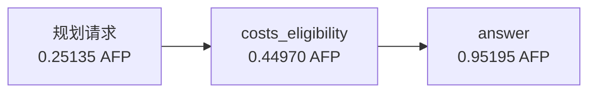

# 首组完整三路线比较

> **后续采样核对修订：** 本页保留阶段原始数值。Native 请求显式 `temperature=0`，
> 旧 DAG 的 Responses 请求未显式携带温度；因此本页涉及 DAG 的差异仅供诊断，
> 不能归因于执行路线。后续按同采样协议补跑 DAG，所有原始调用与费用仍保留。
> 详见[采样控制修订](../../docs/node-tool-one-day-pilot.md#采样控制修订)。

只比较采购任务第一轮，同一 DeepSeek V4 Flash 配置身份、同一最终交付提示与公开材料；
实际请求的采样差异见上方修订。
这是 9 组预定任务—轮次配对中的第一组，尚不能推断总体质量等价或路线普遍优越。

| 路线 | 模型请求 | 字段值及引用 | AFP | 任务秒数 | 累计输入 token | 累计总输出 token |
|---|---:|---|---:|---:|---:|---:|
| 一次性回答 | 1 | fail | 0.976950 | 290.917 | 1090 | 18449 |
| 按需专家 | 3 | pass | 1.234700 | 215.325 | 10308 | 14386 |
| DAG | 3 | pass | 1.653000 | 447.960 | 5181 | 27879 |

本组中，按需专家相对 DAG 费用减少 0.418300 AFP（25.3%），任务时间减少 232.634 秒（51.9%）。
一次性回答数值和条件字段都正确，只有 `confirmed_eligible:sources` 未通过；其费用更低，
不能把它的引用扣分解释成采购金额算错。按需专家与 DAG 在冻结字段及引用检查下均通过。
没有独立人工双审，因此这张表不宣布自由正文或整体语义质量等价。

## 实际 DAG 与规划费用

模型实际规划了两个业务节点：`costs_eligibility` → `answer`；规划请求在业务图之外另计一次。
因此是两个图节点、三个真实模型请求，不得漏掉规划费用。

执行器允许至多 2 个节点并行，但这张图是串行依赖，实际峰值并发为 1。
规划、工作节点和最终交付的实际输出预留均为 384000；计划合同中的 expected_output_tokens 是估计，
不是请求上限。工作节点实际输出 7698、最终节点 16691 token，均正常完成。

## 当前能说明什么

- 三条路线的金额与资格字段都正确；本组完整检查差异在引用。
- 按需专家与 DAG 都用了三个模型请求。成本差异不是少调了模型，而是累计输入和输出的组合不同。
- 按需专家的累计输入更多、累计输出更少；总费用低于 DAG，但仍高于一次性回答。
- 主循环保留历史可能减少重新生成的工作，但本实验还改变了角色提示和上下文投影，不能单独归因于交接损失。
- 专家曾在中间产物中算错 A 的乘法，最终交付没有沿用错值。该细节和原始产物见首个真实专家案例。
- 当前按需专家串行，DAG 并行上限为 2；本组实际 DAG 峰值只有 1，后续仍逐样本记录实际并发。

## 原始证据与限制

汇总快照 SHA-256：`ef4950eb2a250c0b12efc00aeb805f9de1fb1114764f40265a7ca0b31be955b4`。
逐调用原始用量与费用重算见 `../node-tool-pilot-20261029-audit-04/audit.json`，全部核对一致。
DSH 请求的提供方版本可从原始 SSE 直接核对；DAG 当前仅保存解析回执及冻结请求配置，
没有独立保存 HTTP 返回的精确模型版本，不能据此宣称所有服务端版本已经逐次证明相同。
DAG 实际计划原样保存在 `dag-plan.json`；各路线的输入消息、产物和账本位于对应任务目录。
DSH 路线另保留原始 HTTP 请求、SSE 与会话事件。
这份阶段报告不改变主判据、任务、提示或后续执行顺序；完整 27 个比较样本仍在运行。
